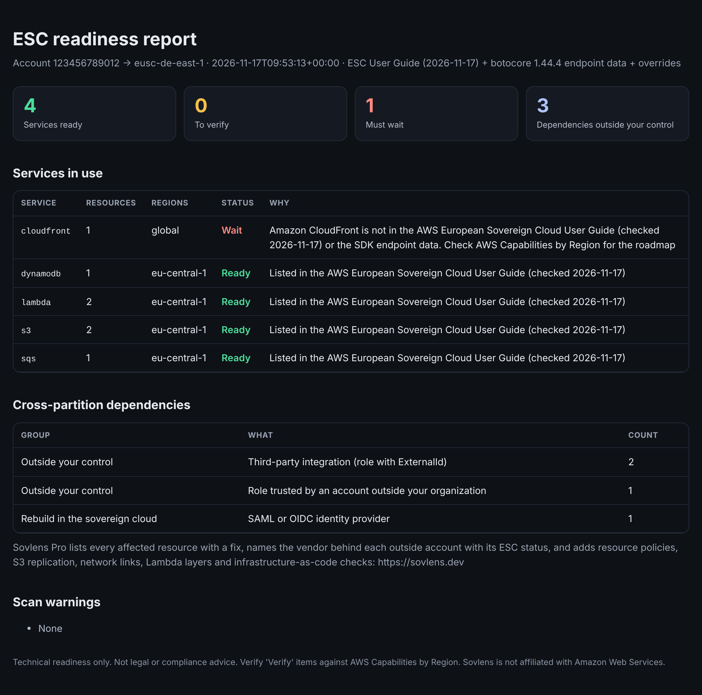

# Sovlens

[](https://github.com/sovlens/sovlens/actions/workflows/test.yml)
[](LICENSE)

**What in this AWS account will not move to the AWS European Sovereign Cloud as-is?**

The AWS European Sovereign Cloud (ESC) is a separate partition, `aws-eusc`, with its own region (`eusc-de-east-1`), accounts and IAM. Moving there is not a region switch: some services are missing, and anything that trusts or talks to another account stops working at the partition boundary.

Sovlens is a read-only CLI that scans one AWS account and tells you:

- **Which services you use** and whether each one is available in the ESC: Ready, Verify or Wait.
- **How many dependencies cross the partition boundary**, however the infrastructure was built (Terraform, CloudFormation or the console):
  - roles trusted by third-party vendors (roles with an ExternalId) and by accounts outside your organization,
  - roles trusted by other accounts in your organization,
  - membership in an AWS Organization,
  - SAML and OIDC identity providers.

It writes a local HTML and JSON report. Nothing leaves your machine.



*Sample report from a test account.*

## Quick start

Requires Python 3.10 or newer and AWS credentials with read-only access.

```sh
pipx install sovlens            # or: pip install sovlens
sovlens scan --profile my-profile
open sovlens-report.html
```

From source:

```sh
git clone https://github.com/sovlens/sovlens && cd sovlens
python3 -m venv .venv && source .venv/bin/activate
pip install .
```

| Option | Meaning |
| --- | --- |
| `--profile` | AWS profile to use |
| `--regions eu-central-1,eu-west-1` | Regions to scan (default: all enabled regions, scanned in parallel) |
| `--target eusc-de-east-1` | Target ESC region |
| `--report html\|json\|both` | Report format (default: both) |
| `--out name` | Report file name without extension |
| `--quiet` | No progress output |

A scan of all enabled regions usually takes a few minutes.

## Permissions

Read-only. The minimal policy is in [`iam/sovlens-readonly-policy.json`](iam/sovlens-readonly-policy.json); `ReadOnlyAccess` or `SecurityAudit` also work. Sovlens never calls an API that creates, changes or deletes anything.

Run it from an account that can call `organizations:ListAccounts` (the management account or a delegated administrator) so it can tell your own accounts from external ones. Otherwise every other account counts as external, and the report says so.

## How the verdicts work

| Status | Meaning |
| --- | --- |
| **Ready** | Listed in the [ESC User Guide](https://docs.aws.eu/esc/latest/userguide/services.html), or has an ESC endpoint in the AWS SDK. |
| **Verify** | Not covered by either source. Check AWS Capabilities by Region. |
| **Wait** | A widely used service that is not in the ESC User Guide and has no ESC endpoint, such as CloudFront. |

The service list is in [`src/sovlens/data/esc_services.json`](src/sovlens/data/esc_services.json), with the date it was last checked. It follows the ESC User Guide rather than SDK endpoint data, because the endpoint data in botocore has no entry for partition-wide services such as IAM, Organizations and Route 53. More on that, and the full list, at [sovlens.dev/esc-services](https://sovlens.dev/esc-services).

Found a wrong verdict? Open an issue with the "Service availability correction" template and a link to the AWS source.

Dependencies are grouped as **Outside your control** (a vendor or another company must act), **Rebuild in the sovereign cloud** (you recreate it in the ESC) and **Code to change** (from your Terraform or CloudFormation files, Pro only).

## Free and Pro

This repository is the free, open-source edition. [Sovlens Pro](https://sovlens.dev) is a separate add-on: install it next to this package and the same `sovlens scan` command produces the full report.

| | Free (this repo) | Pro |
| --- | --- | --- |
| Services in use, with verdicts | Yes | Yes |
| Cross-partition dependencies | Number per type | Every resource, with a fix |
| Vendor behind each outside account, with its ESC status | No | Yes |
| Resource policies (S3, KMS, SQS, SNS) | No | Yes |
| S3 replication, Lambda layers, VPC peering, Transit Gateway, VPN, Direct Connect | No | Yes |
| Hardcoded `arn:aws:` in Terraform and CloudFormation (`--iac`) | No | Yes |
| Organization-wide scan, PDF export | No | Planned |

## Known limits

- Service-level only. Feature-level differences (for example S3 Express One Zone or STS global endpoints) are not checked yet. The ESC User Guide lists them per service.
- Inventory uses the Resource Groups Tagging API plus direct checks for core services. Resources of other services that were never tagged can be missed.
- One account per scan.

## Development

```sh
pip install -e ".[dev]"
pytest
```

See [CONTRIBUTING.md](CONTRIBUTING.md). Security issues: [SECURITY.md](SECURITY.md).

## License

Apache-2.0. Sovlens is independent and not affiliated with, endorsed by or sponsored by Amazon Web Services. It assesses technical readiness only and is not legal or compliance advice.
